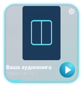

# Шторка, предпросмотр виджетов и обновление стабильной установки

## Изменения

MediaSession и уведомление используют одинаковые данные: название книги — основная строка; номер главы, общее количество и название — вторичная. Из интернет-заголовков удаляются фразы «слушать онлайн». Добавлены DISPLAY_TITLE, DISPLAY_SUBTITLE, DISPLAY_ICON, собственный монохромный значок и largeIcon. Обложка берётся из общего постоянного кеша book-covers и из локальной библиотеки, без привязки исключительно к Download. Версия файла обложки входит в ключ метаданных, поэтому появившаяся позднее обложка обновляет карточку. Прогресс MediaSession имеет монотонную временную отметку; ошибка чтения получает STATE_ERROR с сообщением. Ожидание подготовки ограничено 30 секундами с проверкой поколения, чтобы предыдущая глава не останавливала следующую. Оформлением и обрезкой фоновой обложки системной карточки по-прежнему управляет Samsung One UI / Android.

У трёх виджетов добавлены отдельные previewLayout с собственной высотой; исправлены пропорции fallback-вектора компактного виджета. Живые layouts имеют minHeight. Окно закрепления получает EXTRA_APPWIDGET_PREVIEW с настоящими RemoteViews. В настройках приложения выводятся те же виджеты, отрисованные в выбранной теме, с блокировкой управления внутри макета. Три размера и девять тем — 27 сочетаний. Сохранён старый компонент AudioBookWidget: привязанные ранее виджеты также обновляются.

Стабильная конфигурация выбирается свойством -PaudiobookChannel=stable. Пакет com.audiobookdownloader, папка Download/AudioBooks, прежние имена настроек и компоненты; никаких очисток библиотеки или переноса с удалением. По умолчанию остаётся Preview с отдельными пакетом и библиотекой. Проверена прежняя уборка: каталоги с любыми аудиофайлами, неизвестными файлами или без собственного маркера не очищаются; потеря записи DownloadManager не скрывает готовые главы. Встроенный updater разделяет stable-v / preview-v, названия файлов и пакеты; сохраняет проверку подписи перед установкой.

## Подпись на исходном телефоне

Пользователь уточнил: установленная стабильная сборка собиралась в Code on the Go. В репозитории её ключа нет. Неподписанный кандидат намеренно не подписывается ключом Preview и не предлагается updater как готовая стабильная версия.

Архив Audiobook-stable-sign-on-phone.zip содержит кандидат, инструкцию и sign-phone-update.sh. Скрипт предназначен для терминала Code on the Go, сохраняет ключ на телефоне, проверяет установленный пакет и повышение версии, а после подписи требует точного совпадения SHA-256 сертификата. При несовпадении итоговый APK не экспортируется; установка и удаление не выполняются. Для обычного Gradle debug-ключа используется $HOME/.android/debug.keystore; пользовательский путь и alias можно указать через AUDIOBOOK_SIGNING_KEYSTORE / AUDIOBOOK_SIGNING_ALIAS. Подробности — STABLE-INSTALL.md. Поведение скрипта при совпадении/несовпадении подписей и попытке перезаписи проверено с mock SDK. Подпись реальным ключом пользователя и сохранение его установки на физическом телефоне пока не проверены.

Сведения о среде Code on the Go: https://github.com/appdevforall/CodeOnTheGo/blob/stage/common/src/main/java/com/itsaky/androidide/utils/Environment.java . Это справка о среде, код из неё в Audiobook не копировался.

## Проверки

Финальная сборка 4.2-preview.38 / 100038: https://github.com/smoc1983-web/AudioBook/actions/runs/39751710274 . Все 161 JS-сценарий, по 38 JVM-тестов для Preview и stable и четыре Android-теста прошли; в каждом JVM-варианте пропущен один необязательный сетевой тест. Android-тесты заняли 38.305 с. Результаты и идентичность APK зафиксированы в docs/verification/checks-100038.json, preview-100038.json и stable-candidate-100038.json. Android 36 aosp_atd проверяет приложение, реальное локальное WAV-воспроизведение, MediaController metadata/artwork/state/duration, отсутствие бесконечной загрузки после ошибки, внутренние previews всех 27 сочетаний, навигацию, pagecurl, коллекции и виртуальный датчик встряхивания. Samsung S24 физически не подключён. Проверка системного интерфейса закрепления One UI пользователем всё ещё необходима; тест измерения UNSPECIFIED ловит исходное схлопывание высоты.

ForTanya и книжные источники этим изменением не затрагиваются. Остаются 13 источников, без Lis10Book, Слушкин Всем и Audioboo.

Предпросмотры, отрисованные настоящими RemoteViews на Android 36:

